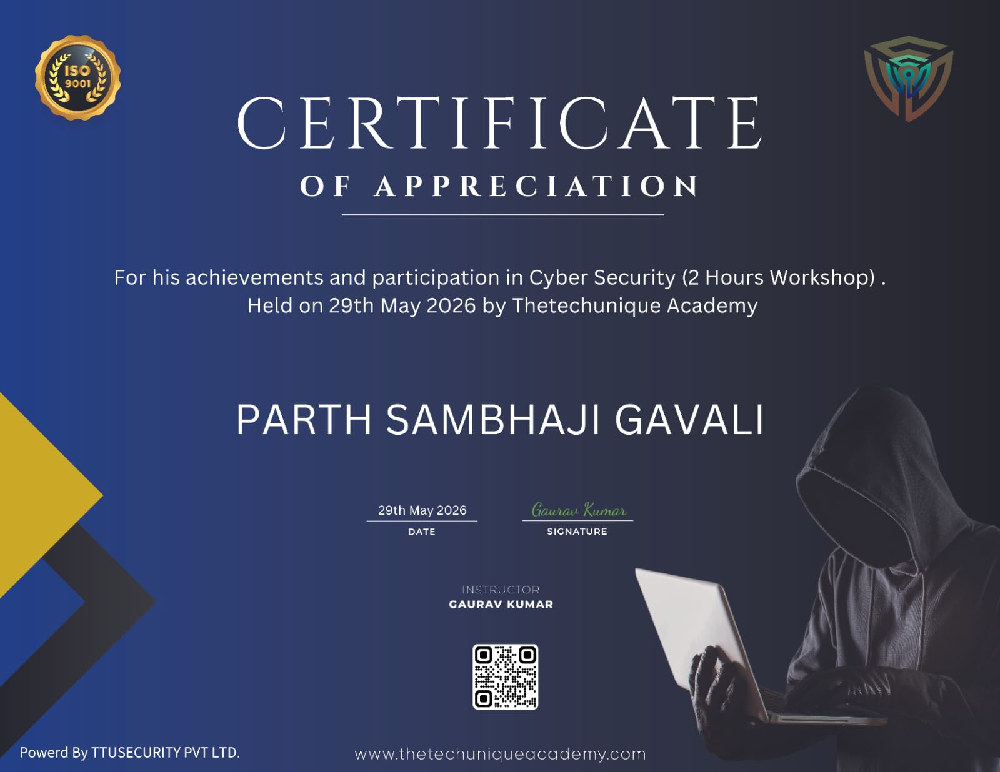

# 🛡️ Cyber Security Workshop

### Certificate of Appreciation | Thetechunique Academy

---

## 📌 Certification Details

| Information | Details |
|:---|:---|
| **Certificate Holder** | Parth Sambhaji Gavali |
| **Workshop Name** | Cyber Security Workshop |
| **Organized By** | Thetechunique Academy |
| **Powered By** | TTU Security Pvt. Ltd. |
| **Certificate Type** | Certificate of Appreciation |
| **Date** | 29 May 2026 |
| **Duration** | 2 Hours |
| **Instructor** | Gaurav Kumar |
| **Category** | Cybersecurity & Information Security |
| **Status** | Participated Successfully ✅ |

---

## 📖 About the Workshop

I participated in the **Cyber Security Workshop**, a 2-hour technical learning session organized by **Thetechunique Academy** on **29 May 2026**, powered by **TTU Security Pvt. Ltd.**

The workshop provided an opportunity to engage with cybersecurity as an important field of computer science and expand my exposure to technical learning beyond regular academic coursework.

For my participation and achievements during the workshop, I was awarded a **Certificate of Appreciation**.

This experience represents another step in my continuous learning journey as a Computer Science Engineering student.

---

## 🎯 Workshop Objectives

My objectives in participating in this workshop were to:

- Explore cybersecurity as an important area of computer science.
- Develop greater awareness of digital security and its significance.
- Understand the relevance of cybersecurity to modern technologies.
- Expand my technical interests beyond classroom learning.
- Gain exposure to technical workshops conducted by industry-oriented training organizations.

---

## 🌟 Participation Highlights

| Highlight | Description |
|:---|:---|
| 🛡️ **Technical Workshop** | Participated in a Cyber Security Workshop |
| 🏫 **Organization** | Thetechunique Academy |
| ⏱️ **Duration** | 2-hour technical session |
| 👨‍🏫 **Instructor** | Gaurav Kumar |
| 📅 **Date** | 29 May 2026 |
| 🏆 **Recognition** | Certificate of Appreciation |

---

## 💡 Learning & Professional Development

Participating in technical workshops is an important part of my academic and professional development.

This workshop encouraged me to further explore:

### 🔐 Cybersecurity Awareness
The importance of understanding cybersecurity and its role in protecting modern digital environments.

### 💻 Technical Knowledge
The relevance of security awareness to computer science, programming, and emerging technologies.

### 🧠 Continuous Learning
The value of attending technical sessions, exploring new subjects, and expanding knowledge beyond academic coursework.

### 🚀 Professional Growth
The importance of developing broader technical awareness while pursuing a career in the technology industry.

> **Note:** The certificate confirms participation in a 2-hour cybersecurity workshop but does not list the individual technical topics covered.

---

## 🚀 Personal Learning Experience

As a **Computer Science Engineering student** with a primary interest in **Artificial Intelligence, Machine Learning, and Data Science**, I believe that exploring different areas of computer science contributes to a stronger technical foundation.

Participating in this cybersecurity workshop was an opportunity to broaden my technical perspective and develop an interest in understanding the security aspects of modern computing systems.

The experience also reinforced my motivation to continue participating in technical workshops, hackathons, and certification programs.

Receiving this **Certificate of Appreciation** represents a meaningful addition to my collection of technical achievements and learning experiences.

---

## 🏆 Certification Achievement

I was awarded a **Certificate of Appreciation** by **Thetechunique Academy** in recognition of my achievements and participation in the **Cyber Security (2 Hours Workshop)** held on **29 May 2026**.

The certificate was issued under the instruction of **Gaurav Kumar**, with **TTU Security Pvt. Ltd.** acknowledged as the supporting organization.

---

## 📜 View Certificate

### 🏅 [View Cyber Security Workshop Certificate](./Cyber_Security_Workshop_Certificate.jpeg)

<b>📷 Click to Preview Certificate</b>

 

---

## 📋 Certificate Summary

**Participant:** Parth Sambhaji Gavali  
**Workshop:** Cyber Security  
**Organization:** Thetechunique Academy  
**Powered By:** TTU Security Pvt. Ltd.  
**Instructor:** Gaurav Kumar  
**Certificate:** Certificate of Appreciation  
**Duration:** 2 Hours  
**Date:** 29 May 2026  
**Status:** Successfully Participated ✅

---

  <b>🛡️ Exploring Cybersecurity • Expanding Knowledge • Building Technical Skills</b>

  <i>Part of my continuous learning journey in Computer Science and Emerging Technologies.</i>

